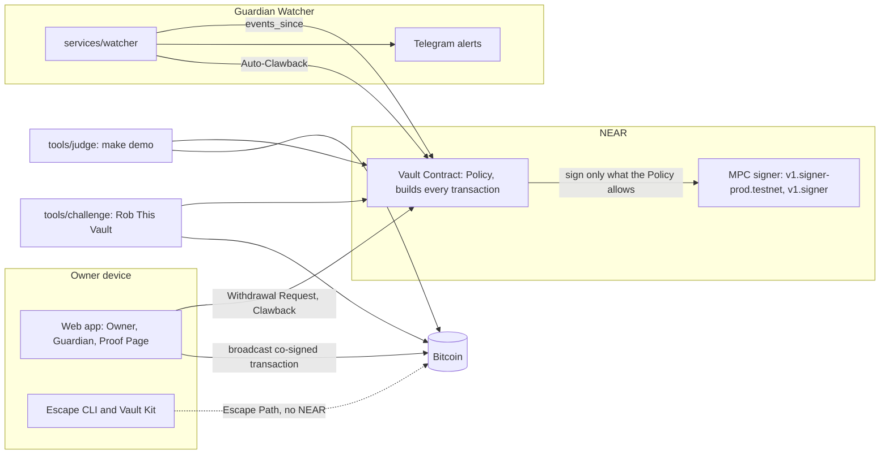

# Morrow

**Bitcoin that can't be rushed.**

Morrow is a time-lock vault for Bitcoin that works today, with no soft fork, no bridge and no wrapped BTC. A public NEAR contract co-signs your Bitcoin through NEAR Chain Signatures, but only after a Delay you chose, and during that Delay any Guardian can send a theft back to your own cold Recovery Address. If NEAR ever disappears, you still leave on your own after a Bitcoin timelock.

## Verify it in one command

You need Docker, Node 24 and pnpm (`corepack enable`). A run takes about 15 minutes and needs no Bitcoin funds, API keys or accounts: Bitcoin runs on a local regtest node, and the NEAR testnet accounts come from the public faucet.

```sh
corepack enable
pnpm install --frozen-lockfile
make demo
```

`make demo` starts Bitcoin Core regtest in Docker, creates fresh NEAR testnet accounts, and runs every Scenario against the Vault Contract on NEAR testnet (`morrow-vault-dev3.testnet`) and the live testnet MPC signer (`v1.signer-prod.testnet`). Each Scenario ends with one line: `PASS`, `FAIL` or `SKIP (not built)`. Any `FAIL` exits non-zero.

## Scenarios

Run one Scenario with its command, or all of them with `make demo`. The expected line and the progress line are exact: CI runs `make demo` and fails if its log lacks any of them (`.github/scripts/check-readme.mjs`).

| Id  | Scenario             | What it proves                                                                                                                                      | Command                          | Expected line                        | Progress line also checked                                                |
| --- | -------------------- | --------------------------------------------------------------------------------------------------------------------------------------------------- | -------------------------------- | ------------------------------------ | ------------------------------------------------------------------------- |
| S-1 | Create               | A real Vault on NEAR testnet. Its Vault Address and Allowance Address are recomputed from the Vault Kit and match what the contract reports.        | `MORROW_SCENARIOS=S-1 make demo` | `S-1 Create PASS`                    | `Co-signer keys derived by the NEAR MPC network (v1.signer-prod.testnet)` |
| S-2 | Withdraw after Delay | Execute before the Delay is refused by the contract. After the Delay the NEAR MPC network co-signs, and the withdrawal confirms on Bitcoin.         | `MORROW_SCENARIOS=S-2 make demo` | `S-2 Withdraw after Delay PASS`      | `Execute before the Delay rejected: ERR_NOT_EXECUTABLE`                   |
| S-3 | Thief and Clawback   | A thief with the real Owner keys requests a withdrawal. A Guardian claws back to the Recovery Address, the thief's Execute fails, and 0 sats leave. | `MORROW_SCENARIOS=S-3 make demo` | `S-3 Thief and Clawback PASS`        | `Attacker received 0 sats`                                                |
| S-4 | Duress               | Not built yet. Will prove that a Duress Session looks normal and that the Guardian Watcher claws the Vault back later.                              | `MORROW_SCENARIOS=S-4 make demo` | `S-4 Duress SKIP (not built)`        | -                                                                         |
| S-5 | Escape               | With only the Owner Key and the Vault Kit, the Escape CLI signs offline and the coins leave after the Escape Timelock. NEAR is not used.            | `MORROW_SCENARIOS=S-5 make demo` | `S-5 Escape PASS`                    | `Vault Kit saved; from here on NEAR is not used`                          |
| S-6 | Policy Change        | Not built yet as a Scenario. Will prove that a Policy Change waits the Policy Change Delay and that a Guardian can veto it.                         | `MORROW_SCENARIOS=S-6 make demo` | `S-6 Policy Change SKIP (not built)` | -                                                                         |
| S-7 | Fast Approval        | Not built yet. Will prove that a Trusted Contact can shorten the Delay only down to the Fast Approval Floor.                                        | `MORROW_SCENARIOS=S-7 make demo` | `S-7 Fast Approval SKIP (not built)` | -                                                                         |

`make kill-near-demo` runs S-5 with NEAR made unreachable on purpose, and prints `NEAR is gone: the contract cannot be reached` before the Escape.

## You hold the Owner keys: try to rob it

S-3 is the attack, scripted. Judge Mode hands you the real Owner Key and Owner Account of a funded Vault, and you use them to request a withdrawal to an address you control.

```sh
MORROW_SCENARIOS=S-3 make demo
```

```text
You hold the Owner keys. Trying to rob the vault…
Thief tries to execute: ERR_CLAWED_BACK
Attacker received 0 sats
S-3 Thief and Clawback PASS
```

The request is public on NEAR and has to wait the Delay. In that time a Guardian claws the whole Vault back to the Recovery Address. After that the contract refuses to co-sign the thief's withdrawal, and Bitcoin script refuses any spend that has only the Owner Key before the Escape Timelock.

To attack with your own code instead of ours:

- `pnpm --filter @morrow/challenge start attack --dry-run` runs the scripted attacker (100 attempts over 3 rounds against a mock Vault Contract) and prints a JSON summary with `sats_to_attackers`.
- When a Rob This Vault round is live, the web app's `/challenge` page offers "Try with these keys": real attempts from your browser with the round's published Owner keys.

## How it works

Coins sit in an ordinary Bitcoin P2WSH address with three spending paths. The Withdrawal Path needs the Owner Key and the Co-signer Key. The Clawback Path needs a Guardian Key and the Co-signer Key, and the contract only co-signs it to the Recovery Address. The Escape Path needs the Owner Key alone, after the Escape Timelock. The Co-signer Key is derived by NEAR Chain Signatures for the Vault Contract, and no person or company holds it. The Vault Contract builds every Bitcoin transaction and sighash itself, so it signs only what its public Policy allows.



## Trust model

What Morrow guarantees:

- **G-1 No instant theft.** A thief who holds both the Owner Key and the Owner Account still has to wait the Delay.
- **G-2 Safe-direction recovery.** Until a withdrawal executes, any Guardian can move the whole Vault to the Recovery Address, and nowhere else.
- **G-3 No hostage.** The Co-signer cannot spend alone. If NEAR stops, the Owner Key alone spends after the Escape Timelock, using only Bitcoin.
- **G-4 No silent rule changes.** No Policy field changes faster than the Policy Change Delay, and any Guardian can veto a change.

What you trust:

1. **T-1** NEAR's MPC network (16 participants, threshold 11) signs only what the Vault Contract requests and stays live. If it stops, G-3 still holds.
2. **T-2** The Vault Contract code is correct. It is open source here, unit-tested and run end to end on regtest, and the Proof Page reads its code hash.
3. **T-3** A Guardian and the MPC network do not collude. This is the one theft path: together they could sign a Clawback Path spend to any address.
4. **T-4** The Owner keeps the Recovery Address key offline.
5. **T-5, T-6** apply only if you enable Fast Approval (a Trusted Contact) or rely on a Guardian Watcher.

## Prior art

| Approach                                    | What it needs                                                                     | What it can do                                                                                    | What it cannot do                                                                 |
| ------------------------------------------- | --------------------------------------------------------------------------------- | ------------------------------------------------------------------------------------------------- | --------------------------------------------------------------------------------- |
| OP_VAULT (BIP-345)                          | A Bitcoin soft fork                                                               | Consensus-enforced delay and recovery                                                             | Run today: the soft fork has not happened, and the proposal was withdrawn in 2025 |
| CTV vaults (BIP-119)                        | The CTV soft fork                                                                 | Precommitted unvault flows                                                                        | Run today: CTV is not active                                                      |
| Presigned-transaction vaults (deleted keys) | Nothing new on Bitcoin                                                            | Delay and recovery today                                                                          | Prove the keys were really deleted, or change amounts and fees after signing      |
| BitVault                                    | The company's co-signing server                                                   | A delay with cancel                                                                               | Prove the delay: it is the company's promise, not a public rule                   |
| Casa / Unchained collaborative multisig     | A multisig with a provider key                                                    | Key recovery and inheritance                                                                      | Delay a spend: a quorum of keys spends at once                                    |
| Morrow                                      | A public NEAR contract that holds no Bitcoin keys, to be locked before submission | A Delay and safe-direction recovery on Bitcoin today, plus an Escape Path that needs only Bitcoin | Stop a Guardian and the MPC network acting together (T-3)                         |

## Sustainability

BitVault sells spend delays by subscription, which shows people pay for this. Morrow's core, the Vault Contract, the web app, the Escape CLI and the Guardian Watcher, stays free, open source and self-hostable. The planned paid layer is an optional hosted Guardian Watcher (alerts, Auto-Clawback, an uptime commitment) and multi-Owner company treasury Vaults. Neither is built yet.

## What is not done yet

The demo Vault's public Proof Page, the hosted live demo, the Rob This Vault recording, the Mainnet Bounty and the locked deployment with its code hash come with their own stories and are not claimed here. Nothing in this repository is deployed on mainnet.

## Repository layout

| Path                    | What it is                                                                                            |
| ----------------------- | ----------------------------------------------------------------------------------------------------- |
| `contracts/vault`       | Vault Contract (Rust, near-sdk): the only place that builds Vault Scripts, transactions and sighashes |
| `contracts/mock-signer` | Sandbox-only stand-in for the NEAR MPC signer                                                         |
| `packages/core-ts`      | Shared TypeScript: contract client, witness assembly, low-S, envelopes, Bitcoin backends              |
| `apps/web`              | Owner, Guardian and Proof Page web app, plus the public site                                          |
| `services/watcher`      | Guardian Watcher: event loop, Telegram alerts, Auto-Clawback                                          |
| `tools/escape`          | Standalone offline Escape CLI (no other repo dependencies)                                            |
| `tools/judge`           | Judge Mode Scenario runner (`make demo`)                                                              |
| `tools/challenge`       | Rob This Vault and Mainnet Bounty operator tooling                                                    |
| `infra/`                | Docker Compose (regtest) and Google Cloud deployment                                                  |
| `evidence/`             | Machine-readable run evidence                                                                         |

## Development

Rust 1.97.1 (installed from `rust-toolchain.toml`), Node 24.22 (`.nvmrc`) and pnpm 12.16.1 (`corepack enable`).

```sh
pnpm install --frozen-lockfile
pnpm lint && pnpm typecheck && pnpm test
cargo test --workspace
make regtest-up   # Bitcoin Core regtest for the integration tests; make regtest-down stops it
pnpm check:readme # this README's Scenario table against tools/judge
```

## How this was built

**Window.** Morrow is an entry to the NEAR Hackathon (2026-11-01 to 2026-11-14). All code in this repository was written in that window.

**Pre-window material.** Before 2026-11-01 the author wrote product research, planning and brand documents and one Chain Signatures spike script. They are kept private and are not part of the submission. The spike called `sign()` on NEAR testnet once to check that the MPC signer returns a signature valid for a P2WSH sighash: transaction `9knPzwxh4kNk2uiq5MiJfJix9YhE9ydNf1SwNJpsj7on` from `timesafe-1029-31513.testnet`.

**AI-generated code.** Most of the code was written with Claude Code, under the author's direction and review. Commits made with it carry a `Co-Authored-By` trailer.

**NEAR tools used.** Chain Signatures (the MPC signer `v1.signer-prod.testnet` on testnet, `v1.signer` on mainnet), NEAR testnet and its faucet, `near-sdk` and `omni-transaction` (Bitcoin transactions and sighashes inside the contract), and `near-api-js`.

**Libraries**, pinned to exact versions in `Cargo.toml` and each `package.json`:

- `contracts/vault`: near-sdk 5.30.0, omni-transaction 0.5.0, bech32 0.12.0, bs58 0.5.1, sha2 0.10.9.
- `contracts/mock-signer`: near-sdk 5.30.0.
- `packages/core-ts`: near-api-js 7.4.0, bitcoinjs-lib 7.0.5, @noble/curves 2.4.0, @noble/hashes 2.4.0, @noble/ciphers 2.2.0, @scure/base 2.2.0, libsodium-wrappers-sumo 0.8.4.
- `apps/web`: react and react-dom 19.3.1, @radix-ui/react-slot 1.5.0, class-variance-authority 0.7.1, clsx 2.1.1, tailwind-merge 3.7.0, @fontsource fonts (Anton, Doto, Funnel Display, Funnel Sans, Geist Mono) 5.3.0. Dev: vite 8.3.5, @vitejs/plugin-react 6.1.2, tailwindcss and @tailwindcss/vite 4.3.3, @playwright/test 1.64.1.
- `services/watcher`: grammy 1.46.0, @noble/curves 2.4.0.
- `tools/escape`: bitcoinjs-lib 7.0.5, @noble/curves 2.4.0.
- `tools/judge` and `tools/challenge`: near-api-js 7.4.0, @noble/curves 2.4.0, bitcoinjs-lib 7.0.5 (challenge).
- Dev, repository-wide: typescript 6.0.3, eslint 10.14.0, typescript-eslint 8.72.1, prettier 3.9.10, vitest 5.0.5, tsx 4.23.15.
- Runtime services: Bitcoin Core 32.1 (Docker `bitcoin/bitcoin:32.1`, pinned by digest), Telegram Bot API.

## License

[MIT](LICENSE)
